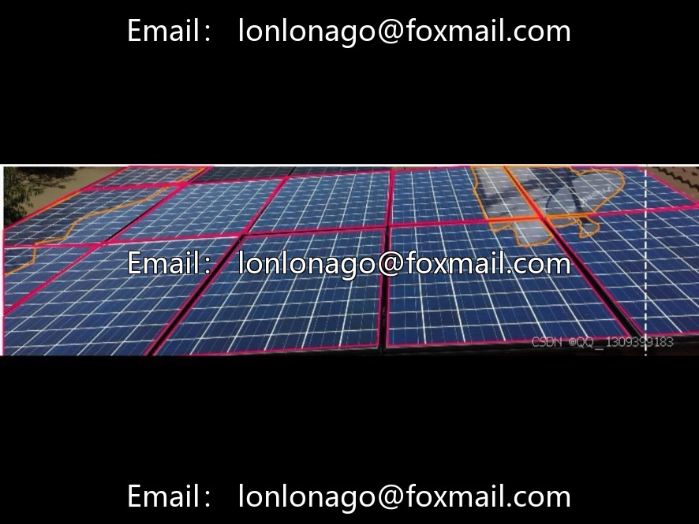
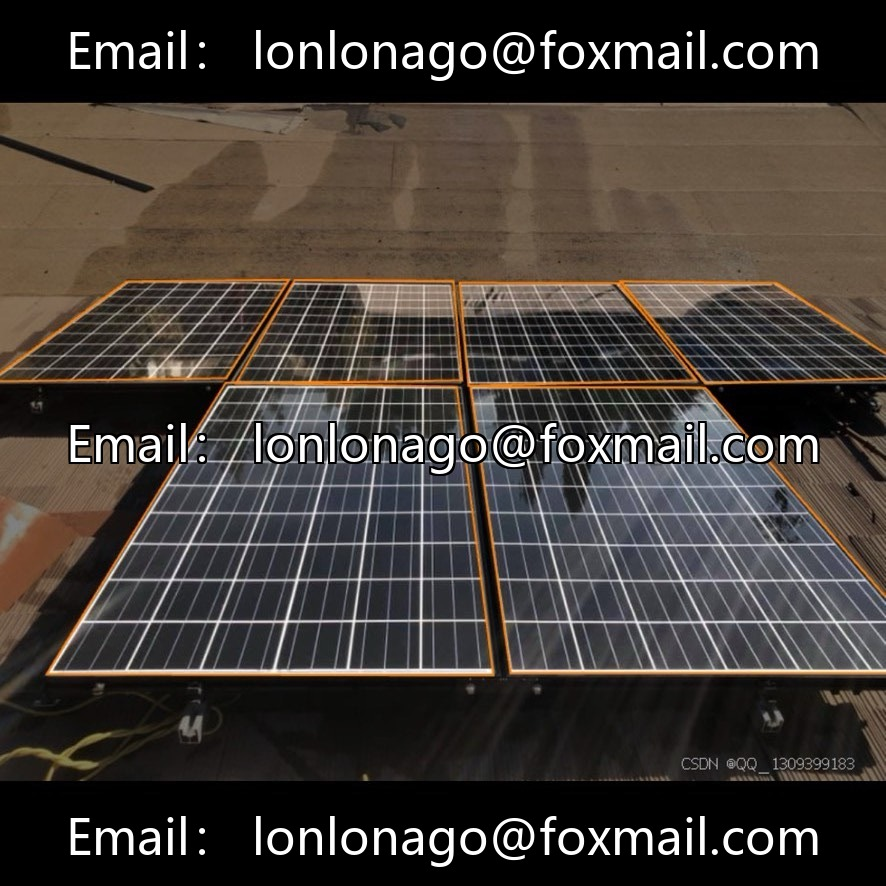
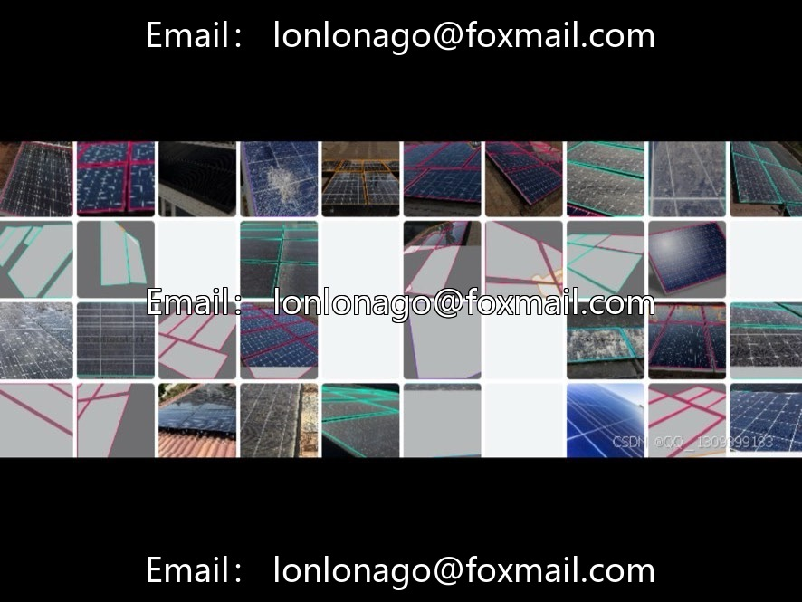
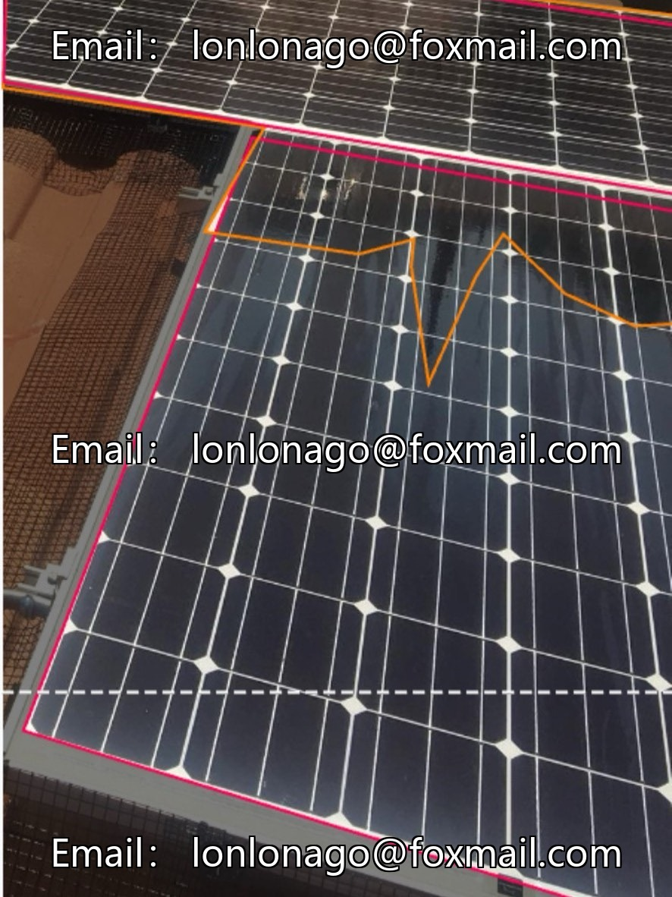
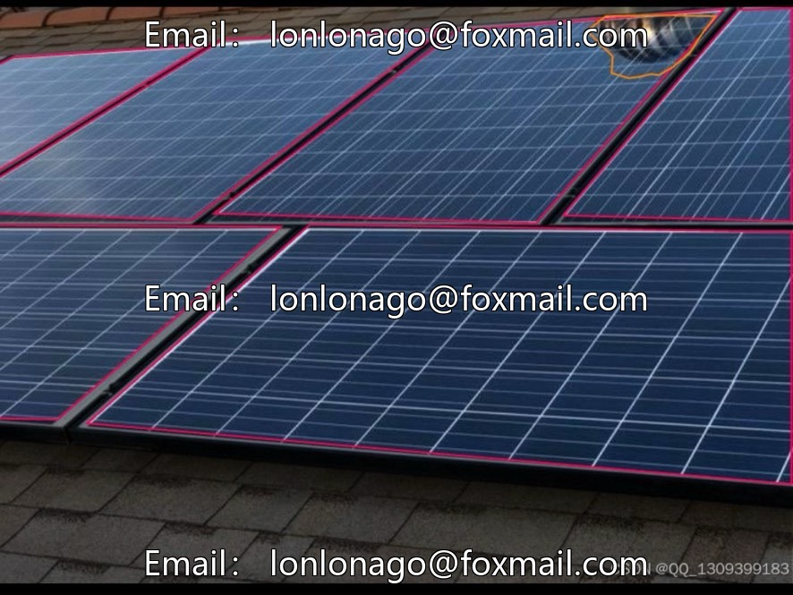
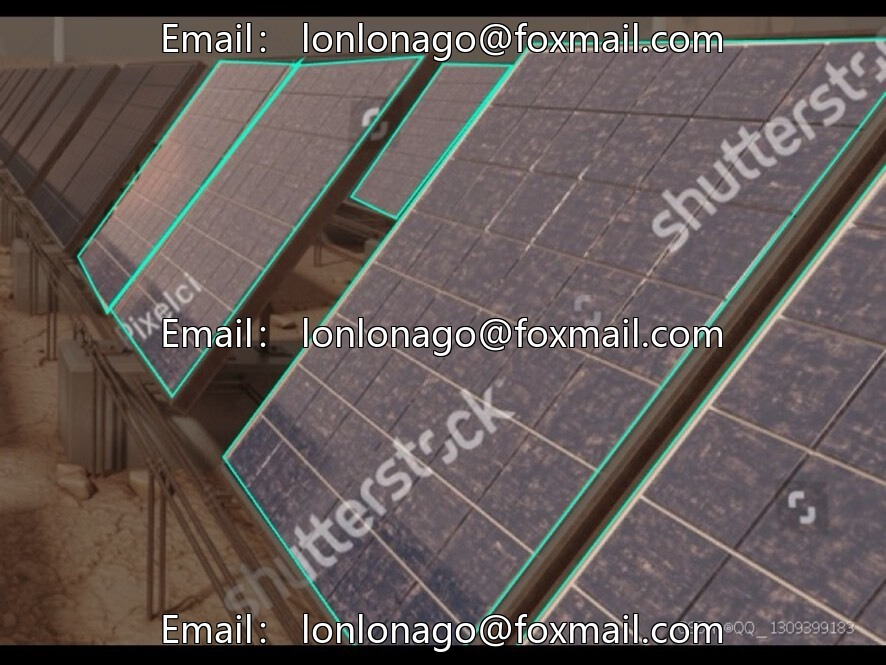
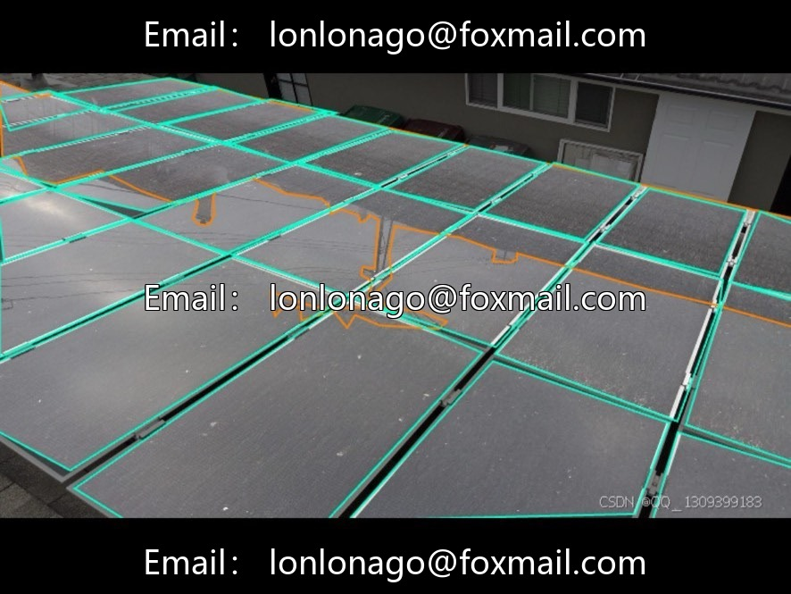

# Photovoltaic solar panel defect identification dataset | Issue 10029

## Body

Photovoltaic Solar Panel Defect Identification Dataset | Issue 10029
Targeted for drone photovoltaic inspection, comprising 1173 actual images, covering large-scale photovoltaic power stations and rooftop distributed photovoltaics, with diverse lighting environments. Supports training with mainstream target detection models such as YOLOv11.

The dataset contains 5 categories of complete annotations: Bird-drop (bird dropping), Clean (clean without defects), Crack (crack), Dusty (dust), Shading (shading), covering more than 90% common faults, the samples are balanced, and the Clean category is slightly more abundant.

The training set consists of approximately 820-940 images, with about 10%-15% reserved for validation/testing sets. Support data augmentation to expand the sample size. Mainstream image resolution 1280×720 ~ 1920×1080, including panoramic and defective close-up shots, with high clarity, capable of recognizing microscopic cracks and dust accumulation to the millimeter level.

Suitable for scenarios such as drone automation inspection, intelligent dispatching of operation and maintenance, and the synergy between cleaning robots.

Virtual materials, once sold, are non-refundable.
Interested friends, click "I want" to proceed.

## Images

## Payment

Here is a pay link on Stripe ( https://buy.stripe.com/3cs8yP7sY87d0vu9AB ). Please contact me lonlonago@foxmail.com after funding $89, and I will send you a complete data files , thank you!

